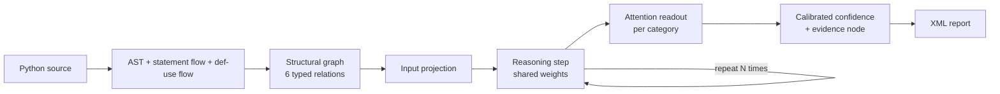

# GSDM — Graph-Structural Decision Model

**A non-transformer neural architecture that reasons over the structure of source code and returns calibrated decisions instead of text.**
Built from scratch in pure NumPy: its own autograd, graph neural network, latent iterative reasoning and confidence calibration.
Ships **GVF (Graph-based Vulnerability Finder)**, the first model on GSDM: a local, explainable vulnerability detector for Python that answers in XML.

[](https://github.com/AnThophicous/gsdm/actions/workflows/tests.yml)
[](https://colab.research.google.com/github/AnThophicous/gsdm/blob/main/notebooks/gsdm_colab.ipynb)
[](LICENSE)


[Português](README.pt-BR.md) · [Specification](docs/SPEC.md) · [Architecture decisions](docs/adr/)

---

## Why GSDM exists

Large language models generate text one token at a time. That is the wrong tool when the question is
*"is this code dangerous, how sure are you, and where?"*. You do not need an essay, you need a decision.

GSDM is built for that kind of question:

| | Transformer LLM | GSDM |
|---|---|---|
| Input | token sequence | **graph**: syntax tree, statement flow, definition→use data flow |
| Output | generated text | **typed decision per category**: probability + boolean + evidence location |
| "Thinking" | chain-of-thought written as text | **latent iterative reasoning**: N rounds of message passing, never verbalized |
| Confidence | heuristic over token logits | **calibrated** per category (temperature scaling, measured with ECE) |
| Runtime | GPU-heavy, cloud API | **NumPy on a laptop**, fully local |

Vulnerabilities such as SQL injection or unsafe deserialization are about **how data flows** from a source to a
dangerous sink. GSDM reads that flow directly from the graph instead of trying to infer it from flat text.

## How it works



1. **Structural graph.** Every AST node becomes a graph node. Edges connect parent and child, consecutive
   statements, and each name's definition to its uses (for example `import pickle` → `pickle.loads(...)`).
2. **Latent iterative reasoning.** One reasoning step with shared weights runs N times:
   `h ← LayerNorm(h + ReLU(Σ_r propagate_r(h)·W_r + h·W_self))`. Each round lets information travel one more hop
   along the data flow. Because the weights are shared, N can change at inference time: think longer on harder code.
3. **Attention readout per category.** Each category pools the nodes with its own attention distribution. The
   node with the highest attention is reported as the **evidence location**, with no line-level labels needed in training.
4. **Calibration.** Per-category temperature scaling, fitted on a held-out split, so `0.80` is meant to be right
   about 80% of the time.

## GVF: the first model on GSDM

GVF scores every Python file against three categories:

| Code | Category | Examples of what it learns to recognize |
|---|---|---|
| VC-1 | SQL / command injection | string-built SQL queries, `os.system` or `subprocess` with unsanitized input |
| VC-2 | Insecure deserialization | `pickle.loads`, `yaml.load` without a safe loader |
| VC-3 | Hardcoded secrets | API keys, tokens and passwords in source code |

These are **learned signals, not regex rules**: node types, identifier subtokens and string-literal statistics
such as entropy feed the model, and the trained model makes the decision.

### Output

```xml
<gvf-report schema-version="1" model="GVF" architecture="GSDM" architecture-version="1.1.0" threshold="0.5000">
  <file path="app/db.py">
    <assessment category="VC-1" name="sql-or-command-injection" confidence="0.9132" flagged="true">
      <location line="12" column="4" />
    </assessment>
    <assessment category="VC-2" name="insecure-deserialization" confidence="0.0410" flagged="false">
      <location line="3" column="0" />
    </assessment>
    <assessment category="VC-3" name="hardcoded-secret" confidence="0.0123" flagged="false">
      <location line="1" column="0" />
    </assessment>
  </file>
  <skipped path="broken.py" reason="syntax-error" />
</gvf-report>
```

No free text, ever: every field is a typed attribute ([schema v1](docs/adr/0004-xml-output-schema.md)).
The exit code is CI-friendly: `0` nothing flagged, `1` findings flagged, `2` error.

## Quick start

```bash
git clone https://github.com/AnThophicous/gsdm.git
cd gsdm
python -m venv .venv
.venv/bin/pip install -e ".[dev]"      # Windows: .venv\Scripts\pip
.venv/bin/pytest
```

Train from a JSONL manifest. Paths are relative to the manifest, an empty label list means clean code, and
`group` names where the file came from (a project, a CVE, a template):

```json
{"path": "samples/sql_concat.py", "labels": ["VC-1"], "group": "cve-2024-1234"}
{"path": "samples/safe_query.py", "labels": [], "group": "internal-api"}
```

```bash
gvf capacity --hidden-size 128                        # parameters and memory, before you train
gvf train dataset/manifest.jsonl --output gvf.npz     # logs, dashboard and checkpoint go to gvf.run/
gvf train dataset/manifest.jsonl --output gvf.npz --epochs 60 --resume   # continue an interrupted run
gvf analyze path/to/project --model gvf.npz --threshold 0.5
```

Try it without installing anything: [open the notebook in Google Colab](https://colab.research.google.com/github/AnThophicous/gsdm/blob/main/notebooks/gsdm_colab.ipynb).

## Is it learning, or memorizing?

A model that has seen near-copies of its validation files will look perfect and fail on new code. GSDM is
built to catch that:

- **Grouped validation.** Whole groups go either to training or to validation, so validation only contains
  code from sources the model never saw. Training warns when the manifest has no groups, or when a category
  has no positive example in validation.
- **LLM-style training logs**, one line per epoch, also written to `metrics.jsonl`:

  ```text
  epoch     train       val       gap     ECE     VC-1     VC-2     VC-3   graphs/s
      8    0.1006    0.3644   +0.2638   0.145        -        -        -      733.3  *
      9    0.0833    0.3635   +0.2802   0.142        -        -        -      723.5  *
     10    0.0678    0.3668   +0.2990   0.095        -        -        -      718.1
  ...
  best epoch: 9 (early stop) | diagnosis: memorizing - validation loss rose 28% since epoch 9 while training loss fell 84%
  ```

  (Real output on the synthetic demo dataset: a dozen templates are not enough to learn the patterns, and the
  diagnosis says so.)
- **A live dashboard** (`dashboard.html`, one self-contained file, no scripts, light and dark mode) with
  training vs validation loss, generalization gap, F1 per category and calibration error.
- **Automatic diagnosis**: `learning`, `memorizing`, `stalled` or `no-validation`, with the evidence.
- **Early stopping and best weights**: training stops when validation stops improving, and the exported model
  uses the best validation epoch, not the last one.
- **Resumable checkpoints**: weights, best weights, Adam state, random state and history. A resumed run is
  **bit-identical** to an uninterrupted one (tested), and resuming refuses a manifest that changed.

## Performance

Measured with `python benchmarks/benchmark.py` on the reference low-end machine: Intel Celeron N4100
(4 cores, x86-64-v2, no AVX2), 3.8 GB RAM, no GPU. Same 53,254-parameter model in both versions.

| | 1.0.0 | 1.1.0 |
|---|---|---|
| Training throughput | 39 graphs/s | **116 graphs/s** (3×) |
| Analyze a 2,000-line file (8,805 nodes) | 868 ms | **637 ms** |
| Peak memory while analyzing it | 34.5 MB | **15.1 MB** |

Where it comes from: graphs are batched into one disjoint graph per step, float32 is the default, and message
passing uses precomputed scatter plans instead of `np.add.at`. There is no hand-written assembly: NumPy's BLAS
already picks CPU-specific kernels at run time, and a hand-tuned AVX2 kernel would crash on the reference machine.

### How big can a GSDM model get?

`gvf capacity` answers before you allocate anything. Reasoning depth does not add parameters (the reasoning step
shares its weights); parameters grow with `(relations + 1) · hidden²`. GSDM 1.1.0 trains in one CPU process:

```text
$ gvf capacity --target-parameters 1e10
hidden size                                37,770
parameters                                 10,000,513,986
weights (inference, float32)               37.3 GB
training state (weights, gradients, Adam)  149.0 GB
estimated training memory                  396.7 GB
```

Billions of parameters need GPUs and distributed training, which this version does not provide. For this task,
the useful range today is thousands to a few million parameters, and the real limit is labeled data.

### Using GSDM for your own model

`gsdm` is domain-agnostic. It knows nothing about Python or vulnerabilities:

```python
import numpy as np
from gsdm.graph import StructuralGraph
from gsdm.nn import GSDMConfig, GSDModel
from gsdm.optim import Adam
from gsdm.training import Trainer, TrainingExample

graph = StructuralGraph.from_edge_lists(
    node_features=np.eye(3),
    edge_lists=[[(0, 1), (1, 2)], [(1, 0), (2, 1)]],  # two relation types
)
model = GSDModel(GSDMConfig(feature_size=3, relation_count=2, decision_count=1, reasoning_steps=4))
trainer = Trainer(model, Adam(model.parameters(), learning_rate=1e-2))
trainer.fit([TrainingExample(graph, labels=np.array([1.0]))], epochs=50)

output = model(graph, reasoning_steps=8)  # reason longer at inference
print(output.logits.data, output.evidence_node(0))
```

## Project status (1.1.0): read this before using it

- ✅ The architecture, batched training, calibration, Python graph builder, XML report and CLI are implemented and tested.
- ✅ Every autograd operation and the full model are **gradient-checked against finite differences**, batched and unbatched.
- ✅ The model learns, and generalizes on, relational graph tasks that cannot be solved without reasoning over structure.
- ✅ Training reports whether the model is learning or memorizing, and checkpoints resume bit-identically.
- ⚠️ **No pretrained GVF model ships with this repository.** There is no labeled Python vulnerability dataset here
  yet. A model trained on a tiny synthetic set memorizes it and misses unseen code, so do **not** rely on GVF
  for security decisions until it is trained on real data.
- Known limitations of this release: simplified control flow (statement sequence only), position-based def-use
  analysis, one file at a time. See [ADR-0008](docs/adr/0008-gsdm-0.1.0-implementation-baseline.md).

## Roadmap

- **Dataset**: a labeled Python corpus for VC-1, VC-2 and VC-3 (the classic public sets, Big-Vul and Devign, are C/C++).
- **GPU backend**: an optional CuPy backend for NVIDIA GPUs, verified against the CPU results on Colab.
- **MCP server** so editors and AI agents can call GVF locally or on a VPS ([ADR-0006](docs/SPEC.md)).
- Later: sparse node features, adaptive reasoning depth, more languages, cross-file data flow.

See [CHANGELOG.md](CHANGELOG.md) for what changed in each version.

## Engineering principles

- **Clean Architecture**: `domain → application → adapters → infrastructure`, with the dependency rule
  **enforced by a test** ([ADR-0003](docs/adr/0003-clean-architecture-layering.md)).
- **Clean Code**: small functions, intention-revealing names, no hidden side effects.
- **Spec-driven**: every decision is recorded as an [ADR](docs/adr/) before code is written.
- **Safe by construction**: model files are `.npz` loaded with `allow_pickle=False`. A deserialization detector
  should not deserialize pickles itself.

```
src/gsdm/     architecture: autograd, graph, nn, optim, calibration, training, session, checkpoint,
              diagnostics, reporting, capacity
src/gvf/      product: domain, application (ports, use cases), adapters (XML, controller), infrastructure, CLI
tests/        unit (with gradient checks), integration (train → analyze → XML), architecture (dependency rule)
benchmarks/   benchmark and synthetic demo dataset
notebooks/    Google Colab notebook
docs/         SPEC.md and Architecture Decision Records
```

## How GSDM relates to other work

GSDM shares an idea with recent *decision models* such as TypeSafe AI's Jev: return typed, calibrated decisions
instead of generated text. Its architecture is its own: it is **native to code structure** (graphs, not text) and
builds on the graph-based vulnerability detection line of research (Devign, VulDeePecker), re-implemented from scratch.

## Citation

If you use GSDM in research, please cite it with the metadata in [CITATION.cff](CITATION.cff)
(GitHub shows a "Cite this repository" button).

## License

[Mozilla Public License 2.0](LICENSE). You can use GSDM in closed-source products. Changes to GSDM's own files
must be shared under the same license.
